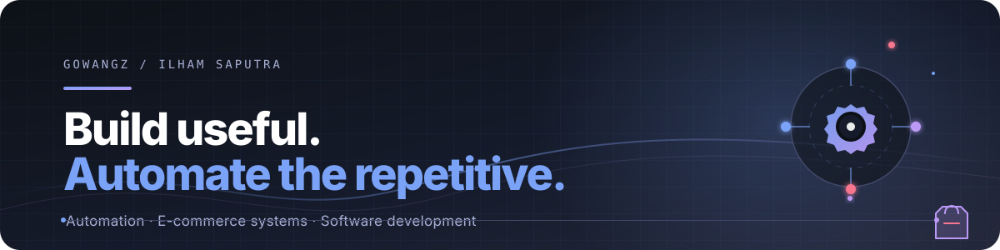

  
  
  
  

<h1 align="center">Hi, I'm Ilham Saputra</h1>
<h3 align="center">Tech Enthusiast · Automation Builder · E-commerce Systems Explorer</h3>

  I build practical software and automation workflows that connect technology with real digital-business operations.

  <a href="https://github.com/Gowangz?tab=repositories">Explore repositories</a>
  ·
  <a href="https://www.instagram.com/ilham.sptraa">Instagram</a>
  ·
  <a href="mailto:ilhamsaputra2605@gmail.com">Email me</a>

## About me

- Informatics Engineering student at **UIN Maulana Malik Ibrahim Malang**.
- E-commerce owner and technology enthusiast focused on **workflow automation**, API-driven systems, and digital growth.
- Currently learning through projects that turn repetitive business processes into reliable, maintainable tools.
- Based in **East Java, Indonesia**.

## Currently exploring

- Workflow automation with Python and GitHub Actions
- API-first e-commerce systems and operational tooling
- Reliable integrations, observability, and maintainable developer workflows
- Practical open-source experiments for digital business

## Recent GitHub activity

<!--START_SECTION:activity-->
- **Pushed commits** in [Gowangz/Routing-VPS-Bot](https://github.com/Gowangz/Routing-VPS-Bot) · 05 Oct 2026
- **Pushed commits** in [Gowangz/GONKAFARM](https://github.com/Gowangz/GONKAFARM) · 05 Oct 2026
- **Pushed commits** in [Gowangz/unikey-v2](https://github.com/Gowangz/unikey-v2) · 05 Oct 2026
- **Pushed commits** in [Gowangz/DigiBot](https://github.com/Gowangz/DigiBot) · 05 Oct 2026
- **Pushed commits** in [Gowangz/DigiBot](https://github.com/Gowangz/DigiBot) · 05 Oct 2026
<!--END_SECTION:activity-->

## What I build

| Area | Focus |
| --- | --- |
| **Automation** | API integrations, repeatable workflows, retry logic, rate-limit handling, and operational tooling |
| **E-commerce systems** | Practical systems that support digital operations, experimentation, and scalable workflows |
| **Software development** | Python-first development with an emphasis on readable code and useful outcomes |
| **Open source** | Sharing experiments, learning in public, and contributing useful improvements |

## Tech stack

  

  
  
  

## GitHub activity

  
  

  

## Let's connect

  
  
  

  <i>Build useful things. Automate the repetitive. Keep learning.</i>

