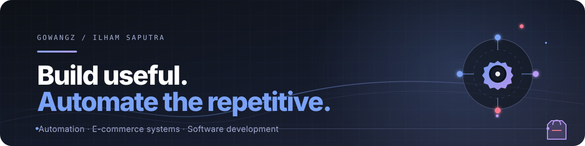

  
  
  
  
  

<h1 align="center">Hi, I'm Ilham Saputra 👋</h1>
<h3 align="center">Backend & Automation Engineer · Network Systems Builder · AI Workflow Explorer</h3>

  
  
  

  I design resilient backend automations, network monitoring systems, and intelligent multi-agent pipelines that bridge practical code with real-world digital operations.

  <a href="https://github.com/Gowangz?tab=repositories"><b>Explore Repositories</b></a>
  ·
  <a href="https://www.instagram.com/ilham.sptraa"><b>Instagram</b></a>
  ·
  <a href="mailto:ilhamsaputra2605@gmail.com"><b>Get in Touch</b></a>

---

## ⚡ About Me

- 🎓 Informatics Engineering student at **UIN Maulana Malik Ibrahim Malang**, East Java, Indonesia.
- ⚙️ **Core Focus:** Building high-throughput API automation engines, proxy rotators, and network tooling with **Python, Bash, and Linux**.
- 🤖 **AI & Tooling:** Orchestrating multi-agent development workflows (**Claude Code, Codex, OpenCode, Hermes Agent**) and local AI gateways (**Magpie**).
- 🌐 **Systems & Infra:** Managing VPS multi-server routing, OpenWrt modem/WLAN setups, and containerized stacks with **Docker Compose**.

---

## 🚀 Featured Projects

| Project | Description | Stack / Highlights |
| :--- | :--- | :--- |
| [**GONKAFARM**](https://github.com/Gowangz/GONKAFARM) | High-performance mass automation system for GonkaRouter API registration, worker-mail OTP extraction, and automated key syncing. | `Python` `PetaniProxy` `9router` `Turnstile` |
| [**STB-TeleMonitor**](https://github.com/Gowangz/STB-TeleMonitor) | Telegram bot engine for monitoring OpenWrt WLAN, STB, and modem devices with auto-alerting and blacklist management. | `Python` `OpenWrt` `Telegram Bot API` `Networking` |
| [**unikey-v2**](https://github.com/Gowangz/unikey-v2) | Resilient API farming engine equipped with dual-proxy failover (Bright Data + PetaniProxy) and rate-limit backoff. | `Python` `Proxy Rotation` `Automation` |
| [**Routing-VPS-Bot**](https://github.com/Gowangz/Routing-VPS-Bot) | Autoscript for managing multi-server VPS network routing and automated configuration deployments. | `Shell / Bash` `Linux VPS` `Network Routing` |

---

## 🛠️ Tech Stack & Capabilities

  

  
  
  
  
  

---

## 📈 Contribution 3D City & Activity

  

  
  

  

---

## 🕒 Recent Activity

<!--START_SECTION:activity-->
- **Pushed commits** in [Gowangz/GONKAFARM](https://github.com/Gowangz/GONKAFARM) · 05 Nov 2026
- **Created new content** in [Gowangz/GONKAFARM](https://github.com/Gowangz/GONKAFARM) · 05 Nov 2026
- **Pushed commits** in [Gowangz/Gowangz](https://github.com/Gowangz/Gowangz) · 05 Nov 2026
- **Pushed commits** in [Gowangz/GONKAFARM](https://github.com/Gowangz/GONKAFARM) · 05 Nov 2026
- **Pushed commits** in [Gowangz/Gowangz](https://github.com/Gowangz/Gowangz) · 05 Nov 2026
<!--END_SECTION:activity-->

---

## 🤝 Let's Connect

  
  
  

  <i>"Build useful things. Automate the repetitive. Keep learning."</i>

